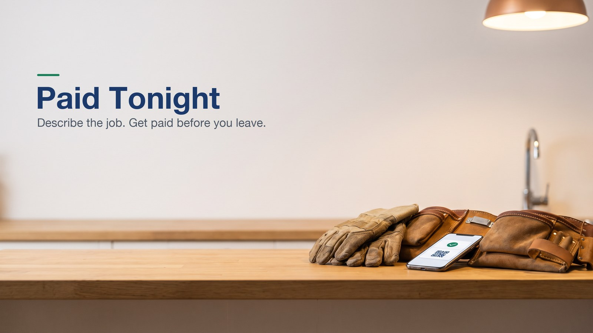
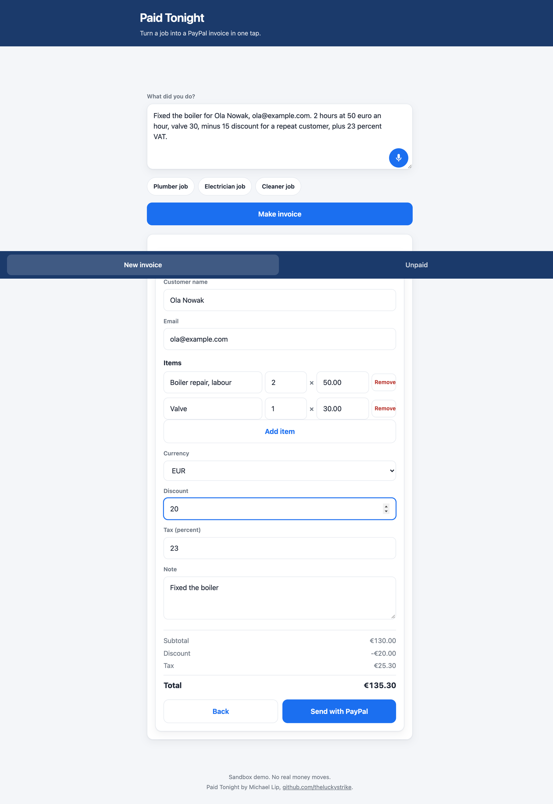

# Paid Tonight



Finish the job, say what you did, and get paid before you leave. Paid Tonight turns a plain description of a job into a PayPal invoice with line items, discount, tax and a QR code the customer can scan on the spot. The Unpaid tab reads your open invoices from PayPal. It sends PayPal's standard reminder when you tap it, and a second AI step drafts a personal message you can send by email in your own words. Built by Michael Lip, [github.com/theluckystrike](https://github.com/theluckystrike), for the PayPal AI Hackathon. The demo video is at https://youtu.be/zyJFPQg8pAY.

> "Fixed the boiler for Ola Nowak, ola@example.com. 2 hours at 50 euro an hour, valve 30, minus 20 discount, plus 23 percent VAT."

| Item | Qty | Price |
|---|---|---|
| Boiler repair, labour | 2 h | 50.00 |
| Valve | 1 | 30.00 |
| Discount | | 20.00 |
| Tax 23% (per line, as PayPal computes it) | | 25.30 |
| Total | | 135.30 |



The preview above is the live demo with 23 percent VAT and a discount. PayPal charges item tax on the line before an item-level discount, so the app bakes the discount into the unit prices instead and PayPal then taxes the discounted amount. A percentage discount bakes in by reducing each unit price, and keeps the effective rate close to the stated percent; when rounding on a tiny amount would move the rate by more than half a point, it falls back to the invoice-level discount with the same warning. A fixed discount bakes in when each line's share divides exactly by its quantity, with the leftover cents on a quantity 1 line. When it cannot, PayPal takes the discount at invoice level, after tax, and the app warns that VAT is charged on the full price.

## Who it is for

Plumbers, electricians, cleaners, tutors, dog walkers and anyone else who does the work first and the paperwork later. Most of them invoice in the evening or at the weekend, and some never do. An invoice sent before they leave the customer's door is an invoice that gets paid.

## How it works

1. You type or speak the job. The browser's speech recognition fills the text box, and a voice language picker follows your browser language until you choose one.
2. The AI reads it and returns the customer, the email, each item with quantity and unit price, a discount amount or percentage in any language, the tax rate and a short note. It never does the arithmetic. The job text is passed to the model as data inside tags, and the model is told to ignore instructions in it.
3. The server checks every field and computes the totals itself with exact integer cents, the way PayPal does. A percentage discount bakes into the unit prices by reducing each unit price and taking the difference from the original line, which is how PayPal rounds a line; tax is computed per line on the discounted line amount, each rounded half up. A fixed discount is split across the lines in exact cents, the leftover cents going on a quantity 1 line, and baked into the unit prices the same way when each line's share divides exactly by its quantity; when it cannot, PayPal takes the discount at invoice level, after tax, and the draft carries a warning that VAT is charged on the full price. A discount the model writes as an item is turned back into a discount, and a percentage discount such as "10 percent off", "10 % Rabatt" or "descuento del 15 %" is applied to every line. Tax rates may have up to 3 decimals. Customer honorifics are removed before the name is split, and a Polish name after u, dla or od gets a warning to check it. Currency words count only next to an amount, so a "euro cylinder lock" stays an item. A currency it cannot invoice (yen, forints) is refused instead of becoming dollars. An email that does not look valid, or does not appear in your description, is flagged, links are removed from the note, and amounts above 100,000 are refused. Warnings you should check also cover a zero price and a tax or discount that is mentioned but not applied, and a draft whose total is zero after a 100 percent discount is refused with an error.
4. You correct anything in the preview (customer, items, currency, discount amount or percent, tax) and tap "Send with PayPal". When a draft gives both a discount amount and a discount percent, the percent wins and the amount box shows the discount the server computes, read only. The server validates the edited draft again, creates the invoice with an invoice number tied to this draft and its content (a retry can never create or email a second invoice, and a corrected draft is never sent as the old one), reads back PayPal's own total and sends only if it equals the total you saw. You get the invoice number, the pay link and the PayPal QR code, and the success card follows PayPal's status every 5 seconds and also on Refresh. Without an email, PayPal emails nobody and you share the QR code or link.
5. In the Unpaid tab, the reminder agent reads your open invoices from PayPal and drafts a message, friendly when the invoice is due or slightly late and firm after 14 days. PayPal's reminder endpoint ignores custom text, so the app says so. "Send PayPal reminder" sends PayPal's standard reminder with the pay button, and "Email this message" opens your own email with the drafted text.
6. The success card shows the total at once, reads the invoice back from PayPal every 5 seconds for up to 2 minutes, and also on Refresh. It shows Unpaid for any status PayPal has not settled, then becomes a green Paid state when PayPal says PAID or MARKED_AS_PAID, and stops polling. "Paid in cash" asks for a confirmation, records the payment with PayPal as CASH for the full amount due, then reads the invoice again and keeps polling. The Unpaid tab drops an invoice that a verified webhook reported as paid and shows it in a small Paid today list.

## PayPal APIs used (sandbox)

| Call | Why |
|---|---|
| `POST /v1/oauth2/token` | Client credentials token, cached until 60 seconds before expiry |
| `POST /v2/invoicing/invoices` | Create the draft invoice with items, a discount baked into the unit prices (or an invoice-level discount when it cannot be baked), tax, the customer and a per-draft invoice number (`PayPal-Request-Id` set too) |
| `GET /v2/invoicing/invoices/{id}` | Read back PayPal's total before sending, and the pay link after |
| `POST /v2/invoicing/invoices/{id}/send` | Send it (to the customer only when there is an email) |
| `POST /v2/invoicing/invoices/{id}/generate-qr-code` | QR code for paying on the spot |
| `GET /v2/invoicing/invoices` | List open invoices for the reminder agent |
| `POST /v2/invoicing/invoices/{id}/remind` | PayPal's standard reminder, only for an invoice that is still unpaid |
| `GET /v2/invoicing/invoices/{id}` | Live status, paid amount and due amount for the success card and Refresh |
| `POST /v2/invoicing/invoices/{id}/payments` | Record a cash payment at the door for the amount due, with method CASH and today's date |
| `POST /v1/notifications/verify-webhook-signature` | Verify every PayPal webhook with its transmission headers and `PAYPAL_WEBHOOK_ID` |
| `POST /v1/notifications/webhooks` | Register the worker webhook URL for PAID, CANCELLED and REFUNDED |
| `POST /v2/invoicing/invoices/{id}/cancel` | Cancel a batch of invoices from the owner-only admin route, with a short note and no emails |

## App endpoints

| Endpoint | Why |
|---|---|
| `GET /api/invoice/{id}/status` | Prefer PayPal's live read, fall back to a stored webhook status only when the read fails |
| `POST /api/invoice/{id}/record-payment` | Record a confirmed cash payment through PayPal, guarded like send |
| `POST /api/paypal/webhook` | Verify and store PAID, CANCELLED and REFUNDED events, idempotent by event id |
| `POST /api/admin/register-webhook` | Owner-only setup, needs the `ADMIN_CODE` secret in the `x-admin-code` header |
| `POST /api/admin/cancel-invoice` | Owner-only cancel of up to 50 PayPal invoices, guarded exactly like the webhook setup route |

## Webhooks

Every event is checked with PayPal before anything is stored. A failed check is refused. A replayed event id changes nothing. The latest status per invoice is kept in the LIMITS KV for 30 days, and the status endpoint still reads PayPal live, so the stored value is only a hint and a fallback. The Unpaid tab uses it to drop invoices that just became paid.

To register the webhook on a deployed worker, set an admin secret first, call the setup route once, then store the returned id.

```bash
npx wrangler secret put ADMIN_CODE
curl -X POST https://your-worker.workers.dev/api/admin/register-webhook \
  -H "content-type: application/json" \
  -H "x-admin-code: YOUR_ADMIN_CODE" \
  -d "{}"
npx wrangler secret put PAYPAL_WEBHOOK_ID
```

The setup route uses the worker origin it was called on plus `/api/paypal/webhook`, registers exactly those three event types and returns `webhookId`. Store that value as `PAYPAL_WEBHOOK_ID`. The route refuses every request when `ADMIN_CODE` is not set.

The cash flow is honest about its source. The demo marks a cash payment through PayPal's own Invoicing API, so the paid status comes from PayPal. No local flag pretends the invoice was paid.

## AI tools used

| Tool | How |
|---|---|
| Workers AI, `@cf/meta/llama-3.3-70b-instruct-fp8-fast` | Reads the job description and returns structured JSON (customer, items, tax, note). Validated with zod, with one retry that appends the error, then a plain error. |
| Same model | Drafts the reminder message from the invoice data (tone from the real due date). Length and tone are checked in code. |
| Browser Web Speech API | Speech to text on the device, for the microphone button. A language picker (Polish, English, German, Dutch) follows the browser language until the speaker picks one. |

The public demo has a daily cap of 60 AI calls so it stays inside the free allowance, and a Cloudflare rate limiting binding is configured at 6 AI calls a minute per address. Cloudflare applies it per location and approximately, so it is a brake rather than a hard cap. Run it yourself to remove the cap.

## Safety and money rules

- Sandbox only, so no real money moves in the demo. The AI never computes money, and totals come from integer cents in code.
- A discount is baked into the unit prices so PayPal charges tax after the discount. A percentage discount keeps its effective rate close to the stated percent, and falls back to PayPal's invoice-level discount when rounding would move it by more than half a point. A fixed discount that cannot divide exactly by each quantity falls back the same way. Either fallback is applied after tax, and the draft carries a warning.
- Nothing is sent to a customer without your tap on "Send" or "Send PayPal reminder".
- The API accepts only `application/json`, so another website cannot post forms to it through your browser.
- The Unpaid response masks each customer email as its first letter, three stars and the domain. The write routes `POST /api/send`, `POST /api/reminder`, `POST /api/remind`, `POST /api/invoice/{id}/record-payment`, `POST /api/admin/register-webhook` and `POST /api/admin/cancel-invoice` are limited to about 20 calls an hour per address, with a plain 429 message when the limit is reached. The limit is approximate, and it fails open if its storage is unavailable. The demo is not locked behind a code unless the owner sets `DEMO_SEND_CODE`.
- Secrets live in Worker secrets, never in the code or the browser. Text from the server is rendered with `textContent`, never as HTML, and pages are served with a strict Content Security Policy (no inline script) and framing denied.

## Status

The AI extraction, money rules, send flow and the payment loop are live and connected to the PayPal sandbox. The loop is proven live in the sandbox. A run created five invoices whose PayPal total equalled the app total to the cent, sent one, returned the QR code and the pay link, returned the same invoice on a retry, listed it as unpaid and sent a PayPal reminder. The German fractional hour case, 3.5 hours at 65.50 and a 1249.00 part with 10 percent off and 19 percent VAT, totals 1583.21 in the tests, the same total the PayPal simulation computes. The status, cash payment, webhook and webhook setup routes are covered by tests against a fake PayPal that follows the Invoicing v2 and Notifications APIs.

## Run it

```bash
npm install
npx wrangler secret put PAYPAL_CLIENT_ID      # sandbox app from developer.paypal.com
npx wrangler secret put PAYPAL_CLIENT_SECRET
npx wrangler secret put DEMO_SEND_CODE        # optional, an access code for send, unpaid, reminders and cash payments
npx wrangler secret put ADMIN_CODE            # required only for the webhook setup route
npx wrangler secret put PAYPAL_WEBHOOK_ID     # after the setup route returns the webhook id
npx wrangler dev
npx tsx --test test/*.test.ts                 # 221 tests, no network (PayPal is a fake in the tests)
```

## License

MIT. Not affiliated with PayPal.
